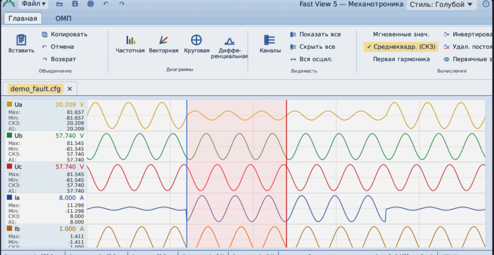

# FastView-REA

[](https://github.com/dmytrobsp/fastview-rea/actions/workflows/ci.yml)

A clean-room, cross-platform (Linux **and** Windows) reconstruction in Rust of
**Механотроника Fast View 5** — the relay-protection oscillogram & characteristic
analysis tool shipped by НТЦ «Механотроника» (www.mtrele.ru) for their БМРЗ
microprocessor protection terminals.

The original is a 32-bit Windows MFC application with an Office-2007 ribbon UI.
This project reverse-engineers both its analysis engine **and its user
interface** and reimplements them as portable Rust that builds and runs the same
on Linux, Windows and macOS.




## Behaviour proven by decompilation

The goal is **behavioural identity with the original, proven against its
decompiled code**, not a look-alike built from screenshots. Every engine *and*
the whole UI layer were reversed with REA + Ghidra and reconciled; the record
is `notes/RECONSTRUCTION_LEDGER.md` (addresses, what was read, what we do,
what is still not determined), with distilled behavioural specs in
`notes/UI_BEHAVIOUR_SPEC.md`, `VIEWS_SPEC.md`, `OMP_SPEC.md`,
`FORMATS_SPEC.md` and `CALC_CHANNELS_SPEC.md`.

- **UI inventory**: `tools/msgmaps.py` lists every MFC message map of
  `FastView.exe` (34 maps, ~350 handlers); each handler's behaviour was then
  decompiled — click regions, selection rules, enable/check (CMDUI) rules,
  wheel and key handling, painting.
- **Window**: tabbed MDI documents (OneNote-style tabs), the Office-2007
  ribbon built in the original's element order, diagram **docking panes**
  beside the always-visible oscillogram (Векторная | Круговая |
  Дифференциальная tab group, Частотная below), bars under the ribbon
  (parameters, ОМП result, merge), six-pane status bar.
- **Oscillogram view**: sample-indexed power-of-two zoom anchored on визир 1,
  fixed 93/20 px lanes, per-channel min..max scaling, every sample drawn,
  five визиры placed on press and dragged when grabbed (no drag-to-pan), the
  original's wheel modifiers / keys / cursor shapes, time ruler and Δt band,
  stats panel fitted to the names, channel selection driving the context
  menus (by click region) and per-channel commands, three comment kinds,
  rectangle vertical zoom, merging oscillograms with three synchronisations.
- **Dialogs**: Каналы, Коэффициенты, file parameters, program settings,
  Проводник (modal finder), Параметры ОМП, comment and colour dialogs.

The look is a faithful egui rendering of the Office-2007 theme, not a
pixel-identical GDI clone (that would need native Win32/MFC and drop
Linux/macOS); proprietary bitmaps are replaced by clean-room drawings.

## What the tool does

A relay engineer picks a **device block** (e.g. *БМРЗ – Защита линий*), sees its
**protection characteristics** (distance protection ДЗ, differential ДЗТ/ДТО,
loss-of-field, out-of-step, power-direction РНМ, universal shapes…), edits the
**settings (уставки)**, and the **operate (срабатывание)** and **reset (возврат)**
boundaries are plotted live in the impedance (R–jX) or differential (Id–Ibrake)
plane. The full characteristic library (17 blocks, 62 characteristics) ships with
the app and is the real `FastView.fvb` from the original, so it is useful out of
the box. A different/updated `FastView.fvb` can be loaded via **Открыть .fvb…**.

## Download

Prebuilt binaries for Linux (x86_64), Windows (x86_64) and macOS (one
universal binary for Apple Silicon and Intel) are attached to each
[release](https://github.com/dmytrobsp/fastview-rea/releases); every push to
`main` also leaves them as CI artifacts. Each download is one archive with
the program, this README and the licences directly inside (no folders). CI
artifacts are zips made by GitHub, which drop the executable bit: on Linux /
macOS run `chmod +x fastview` after unpacking one (release archives keep it).
On Linux the app needs GTK 3 (file dialogs) and a Wayland or X11 session.

## How it was reverse-engineered

Tooling: **REA** (Reverse Engineer Anything) driving **Ghidra 12.1.3** for native
decompilation, plus `7z`/`iconv` for the installer. Full notes:
[`notes/FINDINGS.md`](notes/FINDINGS.md). The scripts that regenerate every
analysis input from your own copy of the program (disassembly, imports,
string table, MFC message maps, RTTI vtables) and the method are in
[`tools/README.md`](tools/README.md). [`index/`](index/README.md) publishes
the factual indexes (message maps, vtables, imports) and a symbol list
naming the functions the notes describe, with a script that loads it into
Ghidra, IDA or rizin / radare2.

1. **Installer** — the `Setup_FastView.exe` is a custom installer with an MSZip
   CAB embedded in its PE resources (`.rsrc/1049/BIN/137`). Extracted with `7z`
   it yields `FastView.exe` (MFC, MSVC 2013 x86), DLLs (`OscillHelper`,
   `ZipArchive`, …), the help `FastView.chm`, and the characteristic library
   `FastView.fvb` (UTF-16 XML).
2. **Data model** — `.fvb` is XML: `blocks → characteristic → parameters / vars /
   geometry`. Every numeric attribute is an expression in a small formula
   language (`tg sin cos sqrt mod` + `^` + arithmetic; angles in **degrees**;
   Cyrillic, case-insensitive identifiers).
3. **Engine confirmation (Ghidra)** — the `.fvb` parser dispatch was confirmed in
   `FastView.exe`; identifiers resolve through a name-keyed map; the renderer
   combines primitives with GDI region booleans (`PathToRegion`/`CombineRgn`),
   i.e. `type=and|or|not` → intersect / union / difference, with operate vs reset
   kept separate (`mode=on|off`).
4. **Validation** — the engine was validated by rendering the shipped library and
   checking the shapes against known relay characteristics (distance polygons,
   mho/sector, differential restraint curves, directional bowtie). See
   `docs/validation/`.

## Features

**Oscillogram** (COMTRADE `.cfg/.dat` ASCII/binary, `.cff`, OSC2 `.osc`):
lanes with the original's geometry, value modes per channel (instantaneous /
RMS / first harmonic), invert / remove-DC / ADC counts reaching every
consumer, channel groups, discrete channels, comments (moment / level line /
area), визиры and status readouts, records loaded on a worker thread.

**Diagrams** (docking panes): круговая (characteristics from the real
`FastView.fvb`, impedance loci, R/X pairs), дифференциальная, векторная,
частотная — each with the original's zoom/pan model, toolbars and menus.

**Analysis**: Быстрый анализ as the original's channel generator (symmetric /
zero sequence / impedances / differential currents / formulas) on the
complete Calculator formula language; **ОМП** single-ended (isolated /
grounded) and double-ended with the result bar, parameters dialog, `.omp`
and `.txt` files; merging oscillograms (sync by start time, fault component
or pre-fault phase; resampling).

## Architecture

```
crates/
  fvb-core/      pure engine, no GUI
    expr.rs        Calculator formula language (tokenizer, grammar, values)
    model.rs parse.rs geom.rs   .fvb library, evaluation, region engine
    comtrade.rs    .cfg/.dat, .cff, .osc readers/writers, time stamps
    signal.rs channels.rs analysis.rs quick.rs   channel math, quick analysis
    omp.rs omp_params.rs        fault location engine, settings, reports
    merge.rs       oscillogram synchronisation and resampling
    views.rs       diagram/readout helpers (scales, SI units, formats)
  fastview-gui/  egui/eframe app
    app.rs         documents, commands, state     main.rs   frame, bars
    ribbon.rs      ribbon, app menu, QAT          theme.rs icons.rs
    lanes.rs oscgeom.rs chansel.rs comments.rs   oscillogram view
    views.rs diagram.rs diagram_ui.rs popmenu.rs  diagram panes
    dialogs.rs chandlg.rs recdlg.rs finder.rs quick_ui.rs omp_ui.rs merge_ui.rs
    persist.rs     settings (characteristics, View, MRU, look)
tools/           msgmaps.py (message-map inventory), index.py, symbols_export.py, …
index/           factual indexes + symbol list (addresses, ids, names)
```

## Build & run

Requires a stable Rust toolchain (1.75+).

```bash
# Linux / macOS / Windows (native)
cargo run -p fastview-gui --release

# run the engine tests
cargo test -p fvb-core

# render a characteristic block to a PNG headlessly (no GUI needed)
cargo run -p fvb-core --example render -- 0 line_protection.png

# validate the oscillogram -> impedance-overlay chain headlessly
cargo run -p fvb-core --example render_overlay -- overlay.png

# generate a fresh synthetic COMTRADE fault record
cargo run -p fvb-core --example gen_demo -- my_fault
```

In the app, use **Файл → Демо-осциллограмма** to load the bundled fault record,
then the tabs show the waveforms, phasors, symmetric components, fault location,
and (on the круговая диаграмма) the impedance trajectory over the zones.

### Windows

The code is cross-platform; build natively on Windows with the same command, or
cross-compile from Linux:

```bash
rustup target add x86_64-pc-windows-gnu
cargo build -p fastview-gui --release --target x86_64-pc-windows-gnu
```

(The GUI hides the console on Windows release builds.)

## Scope & fidelity

What is done, what is approximate and what is not determined is tracked item
by item in the ledger (`notes/RECONSTRUCTION_LEDGER.md`, L1–L9.x) and the
ranked backlog in `notes/UI_BEHAVIOUR_SPEC.md` §9. Known gaps include: native
`.sto` reading (no sample file ships), the original's bitmaps (logo, icons —
replaced by our own drawings), the non-Office-2007 looks, and floating /
re-docking of panes. Every change keeps `cargo build` and `cargo clippy`
warning-free and `cargo test --workspace` green (290+ tests, including
headless tests of the whole window); CI runs them on Linux, Windows and
macOS.

## Contributing

Enable the repository's hooks once per clone: `git config core.hooksPath
tools/git-hooks`. They run `tools/publish_guard.py`, which keeps the original
program and raw decompilation / disassembly output out of the history; CI
runs the same check. Analysis is published as specs in our own words
(`notes/`), as factual indexes (`index/`: addresses, ids and names, no code)
and as tools that regenerate the raw data from your own copy
(`tools/README.md`).

## License

The reconstruction's code is dual-licensed under
[MIT](LICENSE-MIT) or [Apache-2.0](LICENSE-APACHE), at your option.

The program embeds Wine's Tahoma fonts (`assets/fonts/tahoma.ttf`,
`tahomabd.ttf`: Wine's own substitutes, not Microsoft's), which keep their
own licences — the GNU LGPL 2.1 or later and the Bitstream Vera licence —
in [assets/fonts/LICENSE-tahoma.txt](assets/fonts/LICENSE-tahoma.txt); and DejaVu Sans for the
symbols Tahoma lacks ([assets/fonts/LICENSE-dejavu.txt](assets/fonts/LICENSE-dejavu.txt)).

## Legal

This is an independent, interoperable reimplementation created from behavioural
analysis for engineers who need to view these characteristics on Linux. It
contains no original FastView code. `FastView.fvb` is Mekhanotronika's publicly
distributed characteristic data file (downloadable from www.mtrele.ru), used here
as the data the tool reads, exactly as the original does.
